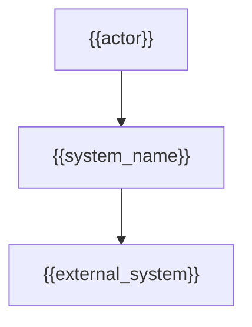
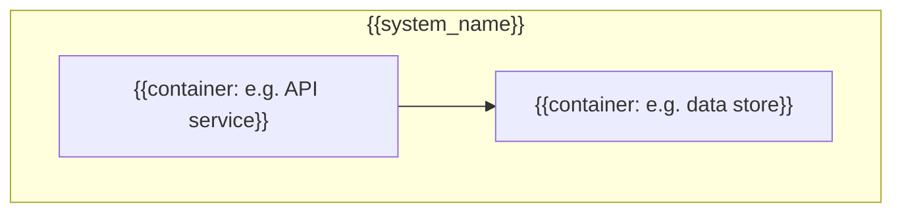
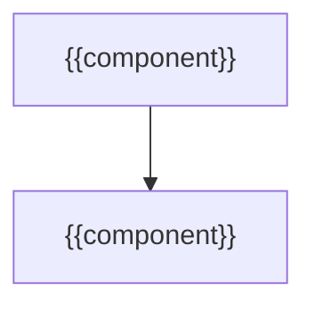
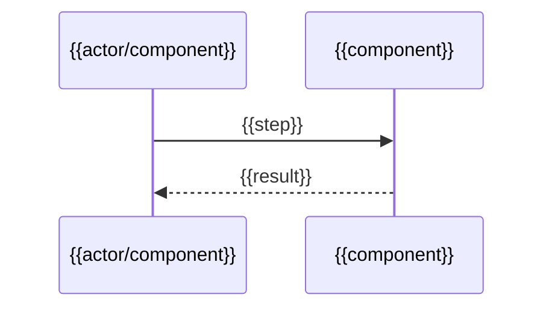
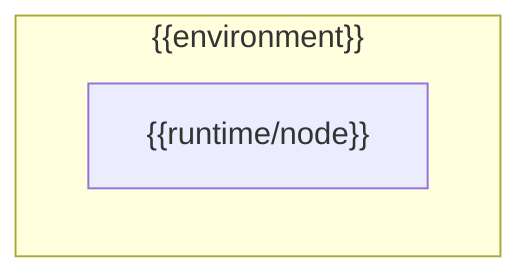

# {{project_name}} — Architecture

> Phase 2 document. Precondition: DESIGN.md approved. Language: user's conversation language.
> Diagrams: Mermaid. Written by the `design-to-tasks` skill.

## How to read this document

This follows the C4 model: Level 1 (Context), Level 2 (Containers), Level 3 (Components),
plus a Dynamic View and a Deployment view. Architectural Decision Records (ADRs) capture
the reasoning behind each significant choice.

## Level 1 — System context

- **System responsibility:** {{what the system does}}
- **Actors:** {{who uses it}}
- **External systems:** {{integrations}}

## Level 2 — Containers

- {{container}} — {{responsibility / tech}}

## Level 3 — Components

- {{component}} — {{responsibility}}

## Dynamic view

Key flow(s) end to end.

## Level 4 — Deployment

- **Environments:** {{dev/cert/prod}}
- **Runtime:** {{platform}}
- **Secrets:** {{how secrets are provided}}

## Cross-cutting concerns

- **Observability:** {{logs/metrics/traces}}
- **Resilience:** {{retries, circuit breakers, fallbacks}}
- **Security:** {{authn/authz, data protection}}

## Architectural Decision Records (ADRs)

### D1 — {{decision title}}
- **Context:** {{forces at play}}
- **Decision:** {{what was decided}}
- **Consequences:** {{trade-offs, positive and negative}}
- **Impact on MVP:** {{in / out / partial}}

## Open gaps

- {{unresolved architectural question}}
