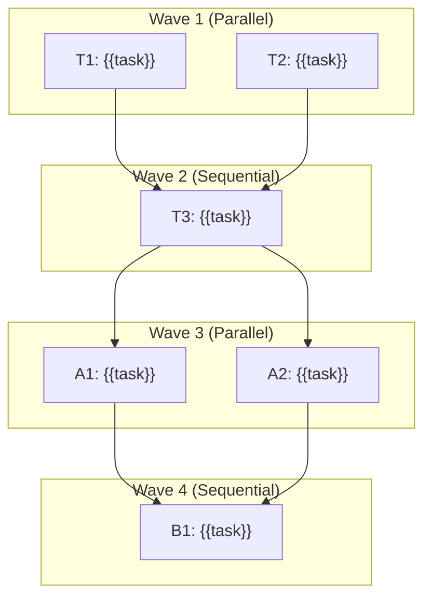

# {{project_name}} — Tasks

> Phase 3 document. Precondition: ARCHITECTURE.md approved. Language: user's conversation language.
> Diagrams: Mermaid. Written by the `design-to-tasks` skill.
>
> This document orchestrates execution: it tracks lifecycle status (`Todo`, `Doing`, `Done`),
> organizes tasks into parallel/sequential execution waves, and links to detailed per-task
> documents located in `docs/tasks/<ID>-<slug>.md` (when versioned in-repo).
>
> Tasks use local, stable IDs (`T1`, `A1`, `B2`, ...).

## Overview

- **Goal of this plan:** {{one line}}
- **Phasing strategy:** {{MVP first, then Phase A/B/C ...}}
- **Status lifecycle:** `Todo` (pending) -> `Doing` (in progress / active branch) -> `Done` (verified & merged)

---

## Execution Sequence & Concurrency (Waves)

Tasks within the same wave can be executed in parallel. Subsequent waves require dependent tasks from previous waves to be `Done`.

### Wave 1 (Parallel)
- [ ] **T1**: {{task_title}} — `docs/tasks/T1-{{slug}}.md`
- [ ] **T2**: {{task_title}} — `docs/tasks/T2-{{slug}}.md`

### Wave 2 (Sequential / Dependent on Wave 1)
- [ ] **T3**: {{task_title}} (depends on: T1, T2) — `docs/tasks/T3-{{slug}}.md`

### Wave 3 (Parallel)
- [ ] **A1**: {{task_title}} (depends on: T3) — `docs/tasks/A1-{{slug}}.md`
- [ ] **A2**: {{task_title}} (depends on: T3) — `docs/tasks/A2-{{slug}}.md`

---

## MVP

| ID | Task | Type | Depends on | Concurrency | Status | Document |
| --- | --- | --- | --- | --- | --- | --- |
| T1 | {{task}} | Feature | — | Parallel (Wave 1) | Todo | [T1-{{slug}}.md](tasks/T1-{{slug}}.md) |
| T2 | {{task}} | Bug | — | Parallel (Wave 1) | Todo | [T2-{{slug}}.md](tasks/T2-{{slug}}.md) |
| T3 | {{task}} | Feature | T1, T2 | Sequential (Wave 2) | Todo | [T3-{{slug}}.md](tasks/T3-{{slug}}.md) |

## Phase A

| ID | Task | Type | Depends on | Concurrency | Status | Document |
| --- | --- | --- | --- | --- | --- | --- |
| A1 | {{task}} | Feature | T3 | Parallel (Wave 3) | Todo | [A1-{{slug}}.md](tasks/A1-{{slug}}.md) |
| A2 | {{task}} | Chore | T3 | Parallel (Wave 3) | Todo | [A2-{{slug}}.md](tasks/A2-{{slug}}.md) |

## Phase B

| ID | Task | Type | Depends on | Concurrency | Status | Document |
| --- | --- | --- | --- | --- | --- | --- |
| B1 | {{task}} | Feature | A1, A2 | Sequential (Wave 4) | Todo | [B1-{{slug}}.md](tasks/B1-{{slug}}.md) |

---

## Dependency graph

---

## Summary

- **Critical path:** {{ordered task IDs}}
- **Parallel opportunities:** {{list of wave groupings}}
- **Highest-risk tasks:** {{IDs + why}}
- **Total tasks:** {{n}}

---

## Appendix — Exporting to a tracker (optional, generic)

This appendix is **optional** and **tool-neutral**. It exists to bridge the agnostic
tasks above to external tracking tools (e.g. Jira, GitHub Projects, Linear) when a team
does not version tasks exclusively in repository markdown files (`docs/tasks/*.md`).

### Field mapping

| Agnostic field (this doc) | Common tracker field |
| --- | --- |
| ID | (local reference / external key created on export) |
| Task / Title | Summary / Title |
| Type | Issue Type (Story, Bug, Task, Chore) |
| Details (`docs/tasks/*.md`) | Description / Acceptance criteria |
| Depends on | Issue link: "is blocked by" / dependency |
| Concurrency / Wave | Execution order / Sprint / Milestone |
| Phase (MVP/A/B) | Label / Fix version / Epic |
| Status | Workflow status / Column (`Todo` -> `Doing` -> `Done`) |

### Generic export steps

1. Pick the target tracker and its project/space.
2. For each task, create an item mapping fields per the table above, populating content from `docs/tasks/<ID>-<slug>.md`.
3. Recreate dependencies from the "Depends on" column as the tracker's link type.
4. Apply the phase as a label/version/milestone per team convention.
5. Record the created external keys back next to each task ID (outside this core doc) if
   traceability is needed.
