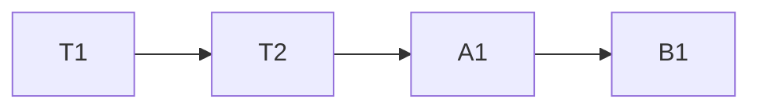

# {{project_name}} — Tasks

> Phase 3 document. Precondition: ARCHITECTURE.md approved. Language: user's conversation language.
> Diagrams: Mermaid. Written by the `design-to-tasks` skill.
>
> This document is intentionally **tool-agnostic**: no external issue keys, custom fields,
> or board/sprint concepts appear below (except in the optional export appendix). Tasks use
> local, stable IDs (`T1`, `A1`, `B2`, ...).

## Overview

- **Goal of this plan:** {{one line}}
- **Phasing strategy:** {{MVP first, then A/B/C ...}}

## MVP

| ID | Title | Depends on | Acceptance criteria | Status |
| --- | --- | --- | --- | --- |
| T1 | {{task}} | — | {{criteria}} | Todo |
| T2 | {{task}} | T1 | {{criteria}} | Todo |

## Phase A

| ID | Title | Depends on | Acceptance criteria | Status |
| --- | --- | --- | --- | --- |
| A1 | {{task}} | T2 | {{criteria}} | Todo |

## Phase B

| ID | Title | Depends on | Acceptance criteria | Status |
| --- | --- | --- | --- | --- |
| B1 | {{task}} | A1 | {{criteria}} | Todo |

## Dependency graph

## Summary

- **Critical path:** {{ordered task IDs}}
- **Highest-risk tasks:** {{IDs + why}}
- **Total tasks:** {{n}}

---

## Appendix — Exporting to a tracker (optional, generic)

This appendix is **optional** and **tool-neutral**. It exists only to bridge the agnostic
tasks above to whatever tracking tool a team uses. A separate tool-specific skill (for
example, a Jira skill) can consume this mapping to materialize the tasks. Do not let any of
this terminology leak into the core sections above.

### Field mapping

| Agnostic field (this doc) | Common tracker field |
| --- | --- |
| ID | (local reference / external key created on export) |
| Title | Summary / Title |
| Acceptance criteria | Description / Acceptance criteria |
| Depends on | Issue link: "is blocked by" / dependency |
| Phase (MVP/A/B) | Label / Fix version / Milestone |
| Status | Workflow status / Column |

### Generic export steps

1. Pick the target tracker and its project/space.
2. For each task, create an item mapping fields per the table above.
3. Recreate dependencies from the "Depends on" column as the tracker's link type.
4. Apply the phase as a label/version/milestone per team convention.
5. Record the created external keys back next to each task ID (outside this core doc) if
   traceability is needed.
